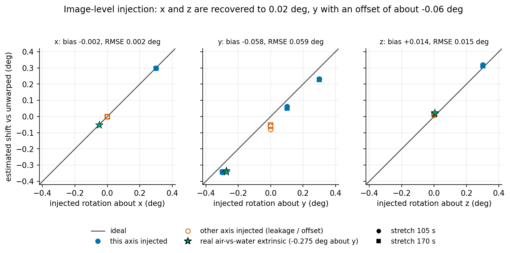
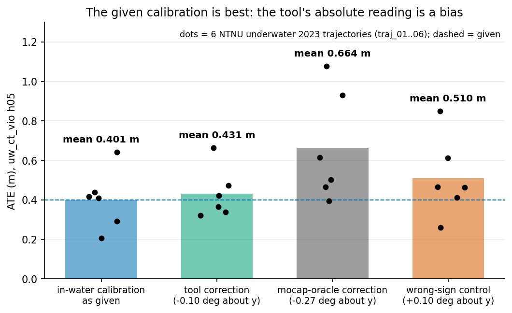

# uw-calib-health

In-water stereo calibration health check (research prototype): from 10-60 s of a normal dive bag it estimates the
per-axis rotation error of the stereo extrinsic and gives a verdict OK / CHECK / RECALIBRATE, with no target and no
motion command.

| Image-level injection: estimated vs injected rotation | VIO check of the absolute reading |
|---|---|
| [](docs/figures/fig1_warp_accuracy.png) | [](docs/figures/fig3_vio_validation.png) |
| NTNU underwater 2023 traj_06, 12 runs: x, z track the injection; y has a ~-0.06 deg offset | uw_ct_vio ATE over 6 NTNU trajectories per stereo extrinsic: the tool's correction makes it worse |

**Status: absolute accuracy is NOT established.** Use it in differential mode (against a reference recorded with a
known-good calibration on the same rig); do not trust its absolute w_y.

## Results

Differential mode on NTNU traj_06 (repeatability across disjoint windows; diff-mode reference is the mean of all
windows of that length, so not independent):

| window | y sd (deg) | abs-mode false alarm | diff-mode false alarm | y +-0.1 flagged (diff) | y +-0.3 flagged (diff) |
|---|---|---|---|---|---|
| 10 s | 0.094 | 0.67 | 0.28 | 0.64 | 0.97 |
| 20 s | 0.044 | 0.56 | 0.00 | 0.50 | 1.00 |
| 30 s | 0.030 | 1.00 | 0.00 | 0.58 | 1.00 |
| 60 s | 0.008 | 1.00 | 0.00 | 1.00 | 1.00 |

Is the +0.10 deg w_y the tool reads on the "good" in-water calibration real? Pre-declared VIO test (uw_ct_vio h05,
6 NTNU 2023 trajectories):

| stereo extrinsic | mean ATE (m) | mean RPE (%) |
|---|---|---|
| in-water calibration as given | **0.401** | **6.75** |
| -0.10 deg about y (tool's correction) | 0.431 | 7.28 |
| -0.27 deg about y (mocap-oracle correction) | 0.664 | 8.58 |
| +0.10 deg about y (wrong-sign control) | 0.510 | 7.24 |

No: the absolute reading is an estimator bias. In differential mode the tool detected every >= 0.2 deg change with
0 false alarms at >= 20 s windows. The real air-vs-water change (-0.275 deg) is recovered as -0.332 / -0.341 deg.

## Quick start

```bash
python3 -m pytest -q tests                  # 13 synthetic tests, ~1.5 s, no bag needed
export UWB_DATA=~/svin_data                 # dataset root: ntnu/..., bus_outside/
python3 extract_cache.py ntnu 105 60        # tracks -> cache/
python3 warp_study.py 105,170               # experiment B (~3 min)
```

## More

- [docs/METHOD.md](docs/METHOD.md): the problem, conventions, the static epipolar and motion/scale methods, fusion,
  verdict thresholds and the observability argument (vertical-disparity figure).
- [docs/RESULTS.md](docs/RESULTS.md): experiments A-D (calibration-side and image-level injection, window length,
  the bus rig), runtime, the full limits list and the VIO validation.
- [docs/USAGE.md](docs/USAGE.md): environment, every experiment command, programmatic use, the synthetic tests.

Known limits: single rig plus one unlabeled rig; translation, intrinsic and time-offset errors are not estimated and
alias into w; bootstrap CIs are optimistic.
