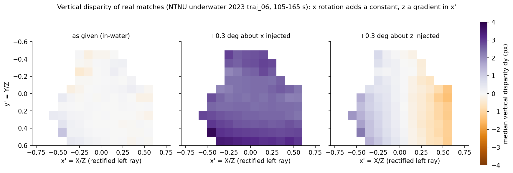

# Problem, conventions and method (details)

[Back to README](../README.md)

Estimates, from a short stretch (10-60 s) of a normal dive bag, the rotation error of a stereo
extrinsic per axis (deg, left-camera x/y/z), the implied disparity bias and depth error, and a verdict
OK / CHECK / RECALIBRATE. No motion command, no target. Status: **prototype with honest baseline numbers;
absolute accuracy is NOT established** (see "Limits" - read it before trusting any number below).

## Problem
On NTNU 2023 using the in-air stereo extrinsic with in-water intrinsics = 0.28 deg about the camera y axis
(~2.2 px disparity bias at f~457 px) gave 15-50 % depth error at 3-8 m and about doubled VIO error.
Rotation about y biases disparity (depth scale vs range), x and z produce vertical disparity.
Measured here: the real air-vs-water difference is w = (-0.051, -0.275, +0.005) deg (x, y, z; `calib.air_vs_water_error_deg`).

## Conventions
`x_l = R_lr x_r + t_lr`; NTNU left = cam1, right = cam0, f = 457 px, B = 0.1097 m. Candidate `R_cand = Exp(w) R_true`
(w in left-camera axes, small-angle ~ same as right axes). The baseline direction is trusted (only rotation is estimated).
Matches are raw pixels, so one extraction serves every candidate calibration.

## Method (`estimators.py`)
Matching/tracking (`tracks.py`, calibration independent): CLAHE, Shi-Tomasi corners in the left image, pyramidal
KLT left->right with forward-backward check (0.3 px) and loose gates (|dy_raw|<12 px), plus KLT left k -> k+gap (6 frames,
0.3 s) for motion. Cv2 fisheye (equidistant) or radtan model for normalisation.

Rays are rotated into a baseline-aligned frame (x' = X/Z, y' = Y/Z, left ray). To first order in w:

    dy (vertical disparity, px) = f [ w_x (1+y'^2) - w_z x' - w_y x' y' ]
    dd (disparity bias,  px)    = f [ w_z y' + w_x x' y' - w_y (1+x'^2) ]

1. **Static epipolar fit** (`epipolar_fit`): Tukey-IRLS of dy on the three basis functions, iterated 3x with re-rectification.
   w_x and w_z are strongly observable. w_y appears only via the second-order x'y' term.
2. **Motion/scale-consistency** (`motion_intercept`, method (c) of the brief): the left-only essential matrix between frames
   k and k+gap gives inverse depth x_inv up to a per-pair scale. Stereo disparity must obey d = alpha_p x_inv + c(1+x'^2)
   with alpha_p = f B / s_p free per pair; the shared intercept c = -f w_y is a disparity bias that no scale can absorb
   (z_est = f B/(d+b): range-dependent motion scale). Solved by variable projection, effective-variance IRLS (errors in x_inv are
   propagated; plain OLS is attenuated).
3. **Fusion**: w_y = inverse-variance (block-bootstrap) average of 1 and 2; w_x, w_z refit with that w_y removed
   (x/z <-> y coupling otherwise leaks: the free 3-parameter fit is poorly conditioned for z). 90 % CI = block bootstrap
   (4-keyframe blocks) over keyframes.
4. **Verdict** (`verdict`, thresholds fixed a priori, tied to implied depth error `err(Z) = |w_y| Z / B`):
   RECALIBRATE if err(3 m) >= 10 % or RMS vertical disparity >= 1.5 px; CHECK if err(8 m) >= 10 % or RMS vertical disparity >= 0.7 px.
   For NTNU: w_y = 0.079 deg -> CHECK, 0.21 deg -> RECALIBRATE; vertical disparity 0.7 / 1.5 px = 0.09 / 0.19 deg about x.

**Pressure depth (method (a)) was not implemented**: over the 60 s stretches the vehicle's vertical excursion is only 0.1-0.4 m
(mocap) while the motion is mostly horizontal, so a pressure-referenced scale constrains almost nothing. IMU method (b) not tried.

## Observability argument and what the data say

*Figure 4. Median vertical disparity (px) of the tracked left-right matches in rectified left-ray coordinates, NTNU underwater 2023 traj_06, 105-165 s (bins with >= 30 matches). Left: the given in-water calibration. Middle / right: the same matches with +0.3 deg injected about x (adds a nearly constant dy) and about z (adds a gradient in x'); these two panels are calibration-side injections, shown only to illustrate the basis functions.*
The brief assumes w_y is invisible to a single stereo pair. In theory it is only *weakly* visible: through the x'y' term of the
epipolar field (and its twin, translation-direction t_z, which we do not estimate). With NTNU's wide fisheye (|x'|,|y'| up to 0.6) the
term is large enough to be measured: static epipolar w_y has bootstrap SE 0.017 deg on 60 s, the motion method 0.058 deg (0.04-0.14 depending on
extraction settings). The motion method is the physically independent check but is ~3x noisier here and the fused value is dominated by the static fit.
Caveat: the static w_y term is also what intrinsic/distortion-model error would look like, so it can absorb such error (not separable here).
