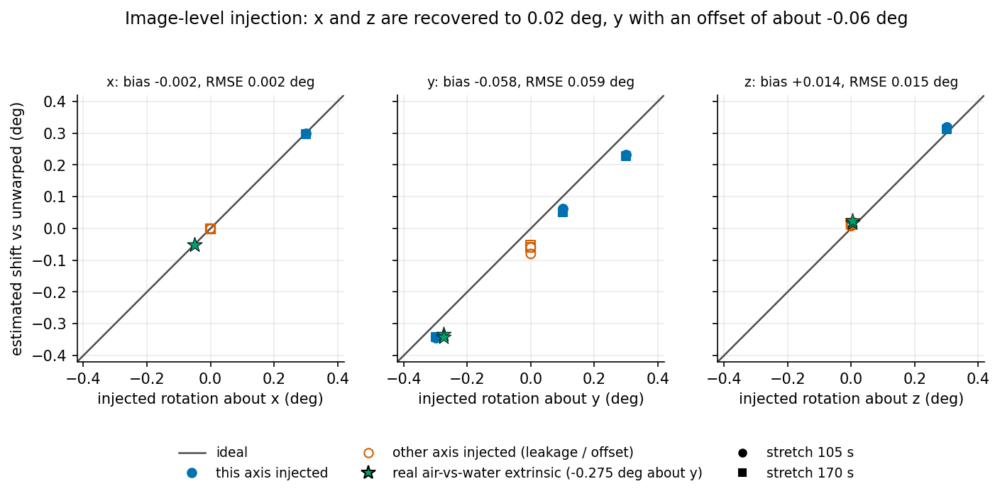
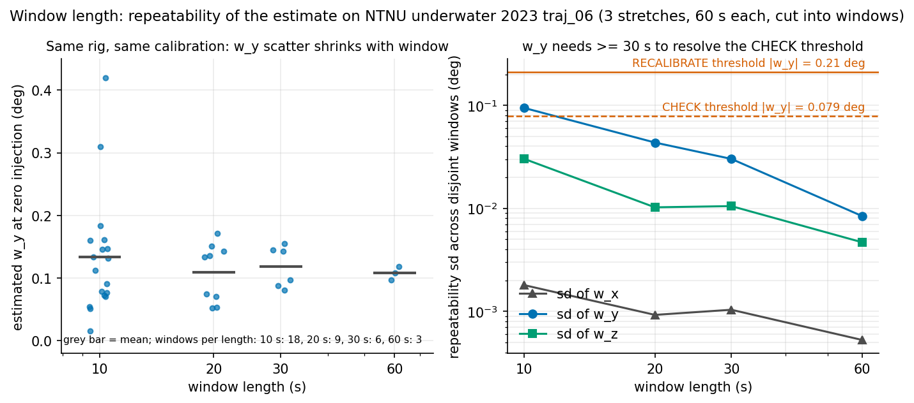
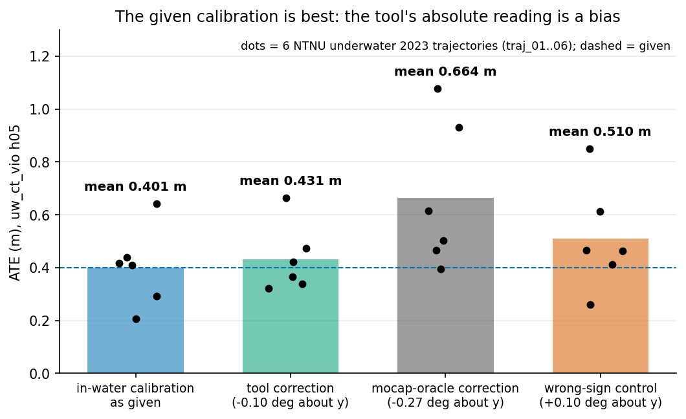

# Results, limits and VIO validation (details)

[Back to README](../README.md)

## Results (all numbers produced by the scripts in this dir; logs in `results/`)

### Experiment A: calibration-side injection (`baseline.py`, `summarize.py`; 3 eval stretches 105-165, 170-230, 235-295 s of traj_06, 60 s each; dev stretch 40-100 s used for tuning)
Estimated shift (est - estimate at zero injection on the same stretch) equals the injected value to <= 0.001 deg on every axis and level
(x,z,y rows in `results/results_summary.txt`). **This is equivariance by construction** (identical matches, only R_cand changes) and
validates sign conventions/linearity only; it is NOT a measurement-accuracy figure. Off-axis leakage <= 0.001 deg.

What injection of the real in-air extrinsic gives: fused estimate -0.171 deg (mean of 3 stretches) = +0.103 (residual of the GOOD calibration) - 0.275 (true air-water difference).

Estimator on the *unperturbed* in-water calibration (injected = 0), fused, deg:

| stretch | w_x | w_y | w_z |
|---|---|---|---|
| 40-100 (dev) | +0.002 | +0.170 | -0.014 |
| 105-165 | +0.001 | +0.112 | -0.006 |
| 170-230 | +0.002 | +0.102 | -0.002 |
| 235-295 | +0.001 | +0.098 | +0.004 |

=> a **constant offset of about +0.1 deg in w_y** that the in-water "GOOD" calibration reads. Either the in-water calibration retains a real
y residual (an oracle with mocap scale, `validate_gt.py`, finds +0.26 / +0.29 deg on two stretches, sign agrees, magnitude does not;
that oracle itself is noisy: unknown body-camera lever arm, stereo/GT scale ratio IQR 0.99-1.40) or the estimator has an absolute bias
(e.g. intrinsics). **Unresolved.** Consequence: in absolute mode the GOOD rig is flagged CHECK on 3/3 stretches (false-alarm rate 1.00).

Verdict table, absolute mode, per level (3 stretches, flagged = verdict != OK; "truth" = verdict of the injected value alone):

| injected | axis | flag rate | verdict == truth |
|---|---|---|---|
| 0 (false alarm) | all | 1.00 (CHECK) | 0.00 (truth OK) |
| 0.1 | x / y / z | 1.00 / 0.50 / 1.00 | 1.00 / 0.33 / 0.00 |
| 0.2 | x / y / z | 1.00 / 1.00 / 1.00 | 1.00 / 0.50 / 0.00 |
| 0.3 | x / y / z | 1.00 / 1.00 / 1.00 | 1.00 / 0.50 / 1.00 |
| 0.5 | x / y / z | 1.00 / 1.00 / 1.00 | 1.00 / 1.00 / 1.00 |

(the +-0.1/+-0.2 y cases are decided by the +0.1 offset, not by the injection; z is verdicted CHECK from 0.3 deg because 0.2 deg about z is only ~0.5 px RMS vertical disparity.)

Differential mode (reference = estimate on a different stretch of the same rig, dev stretch 40-100): false alarm 0.00; flag rate for y = +-0.1 deg 0.50, for any |w| >= 0.2 on x, y: 1.00.

### Experiment B: image-level injection (`warp_study.py`, stretches 105 and 170; the RIGHT image is resampled as if the camera were rotated, tracks re-extracted, GOOD calibration unchanged) - the honest accuracy test of the whole chain
Shift of the fused estimate relative to the unwarped stretch vs injected w (deg); n = 12 (5 injections + air case, 2 stretches):

| axis | bias of (shift - inj) | RMSE |
|---|---|---|
| x | -0.002 | 0.002 |
| y | -0.058 | 0.059 |
| z | +0.014 | 0.015 |

y: +0.3 -> +0.233 / +0.227; -0.3 -> -0.345 / -0.341; +0.1 -> +0.062 / +0.050; air case (-0.275) -> -0.332 / -0.341. y shift is also -0.05..-0.08 for
x and z injections, i.e. a nearly constant offset introduced by the warp (suspected resampling blur/interpolation mismatch between left and right; not
investigated), so the y *slope* is ~0.95-1.0 and the offset ~-0.06 deg (0.5 px). Detection of the real air-extrinsic change (differential verdict) = RECALIBRATE on both stretches.

*Figure 1. Experiment B on NTNU underwater 2023 traj_06 (stretches 105 and 170 s): estimated shift vs injected rotation per axis (all 12 runs of `results/warp_study.json`). Open red markers are runs where a different axis was injected: they show the leakage (x, z) and the constant ~-0.06 deg offset (y). The calibration-side injection (Experiment A) is equivariant by construction and is deliberately not plotted.*
Per-method y shift in the warp study: static epi and motion agree within 0.03-0.2 deg (motion is noisier, e.g. x+0.3 on 170: +0.144).

### Experiment C: window length (`window_study.py`, `summarize_window.py`), injection of 0, y+-0.1, y+-0.3, x+0.2, z+0.2; windows of the 3 eval stretches
Repeatability of the unperturbed estimate across disjoint windows:

| window | n | y mean | y sd | x sd | z sd | abs-mode false alarm | diff-mode false alarm | y+-0.1 flagged (diff) | y+-0.3 flagged (diff) |
|---|---|---|---|---|---|---|---|---|---|
| 10 s | 18 | +0.134 | 0.094 | 0.002 | 0.030 | 0.67 | 0.28 | 0.64 | 0.97 |
| 20 s | 9 | +0.109 | 0.044 | 0.001 | 0.010 | 0.56 | 0.00 | 0.50 | 1.00 |
| 30 s | 6 | +0.118 | 0.030 | 0.001 | 0.011 | 1.00 | 0.00 | 0.58 | 1.00 |
| 60 s | 3 | +0.108 | 0.008 | 0.001 | 0.005 | 1.00 | 0.00 | 1.00 | 1.00 |

(diff-mode reference here = mean zero-injection estimate of all windows of that length, i.e. NOT independent; y sd at 60 s is from only 3 stretches.)
Practical resolution on this rig: x < 0.01 deg, z ~0.01 deg, y ~0.03 deg (30 s) to 0.09 deg (10 s) repeatability; w_y changes of >= 0.1 deg are detectable only from >= 60 s,
>= 0.3 deg from 10 s.

*Figure 2. Experiment C on NTNU underwater 2023 traj_06: zero-injection estimates per disjoint window (left) and their sd per axis (right) against the verdict thresholds on |w_y| (0.079 deg CHECK, 0.21 deg RECALIBRATE; the thresholds for x and z are 0.09 / 0.19 deg). The 60 s point rests on 3 stretches only.*

### Experiment D: bus_outside, given calibration, radtan 1600x1200, B = 0.2318 m, f = 1167 px (`run_bus.py`; no GT for the true error)
| stretch | matches / mono feats / pairs | w_x | w_y fused (epi) | 90 % CI y | motion y (SE) | RMS dy | verdict |
|---|---|---|---|---|---|---|---|
| 100-160 | 3417 / 608 / 14 | +0.095 | -0.305 (-0.301) | [-0.531, -0.201] | -4.0 (3.4) | 2.2 px | RECALIBRATE |
| 250-310 | 2974 / 890 / 21 | +0.087 | -0.336 (-0.334) | [-0.392, -0.259] | -2.7 (1.5) | 2.1 px | RECALIBRATE |
| 400-460 | 7104 / 2347 / 27 | +0.096 | -0.500 (-0.498) | [-0.583, -0.454] | -2.0 (1.5) | 2.4 px | RECALIBRATE |

The bus stretches agree in sign and are consistent in w_x (+0.09) but w_y varies by 0.2 deg between stretches, more than the bootstrap CIs; the motion method cannot confirm
anything here (few tracked pairs, SE >> 1 deg). Treat as "something to look at", NOT a verified error: the bus rig was not necessarily calibrated in water, the radtan
model of a 1600 px lens may leave systematic x'y' residuals, and the CIs are likely too narrow.

### Runtime (laptop CPU, single process)
Extraction (KLT, 60 s of 20 Hz pairs, 800 corners, 10 Hz keyframes): 6-8 s warm (22-33 s when other jobs ran); prepare 1.1 s; estimate without CI 0.3 s; with 30 bootstrap draws ~9.5 s per candidate.
Bag decode dominates 60 s of data. No GPU.

## Limits (be explicit)
- Absolute accuracy of w_y is not established: the estimator reads +0.10 deg on the GOOD in-water calibration; the oracle suggests the true residual may be larger, the estimator may be biased by intrinsics. Only *changes* (differential mode) are validated, and only in simulation of error (A, B), plus one real change (air extrinsic) which is recovered (-0.275 true, -0.332 / -0.341 estimated from warped images).
- Single rig (NTNU, flat-port camera in a tank, ranges ~1.2-4 m: disparity 12-42 px) plus one unlabeled second rig. Depth-error thresholds are computed for 3 and 8 m but the data contain few points beyond 4 m.
- Baseline direction/translation errors, intrinsic errors, time offsets and rolling effects are not estimated; they alias into w.
- w_y from the static term needs a wide field of view and well-distributed matches; the motion method needs parallax and range diversity and is noisy (SE 0.04-0.14 deg NTNU, >1 deg bus).
- Verdict thresholds are fixed by the depth-error argument, not tuned to maximise detection; extraction settings (gap 6, 800 corners, temporal FB 0.5 px) were picked on the dev stretch (40-100 s), the same bag as the eval stretches (different time spans, same vehicle/scene).
- Bootstrap CIs are optimistic: matches are not independent, and stretch-to-stretch spread (bus) exceeds them.
- Warp experiment shows a ~-0.06 deg y offset of unknown origin (likely resampling blur).

## Validation in the VIO: is the +0.10 deg w_y reading real? (ws1, 2026-11-04) - NO

Pre-declared test: rotate the in-water stereo extrinsic (T_cn_cnm1) by the correction each hypothesis implies
and run uw_ct_vio (best config h05) on all 6 NTNU 2023 trajectories. If the tool's absolute reading were right,
the -0.10 deg correction should improve ATE.

| stereo extrinsic | mean ATE (m) | mean RPE (%) |
|---|---|---|
| in-water calibration as given | **0.401** | **6.75** |
| -0.10 deg about y (tool's correction) | 0.431 | 7.28 |
| -0.27 deg about y (mocap-oracle correction) | 0.664 | 8.58 |
| +0.10 deg about y (wrong-sign control) | 0.510 | 7.24 |

The given in-water calibration is best; both corrections and the control are worse. So the +0.10 deg absolute
reading is an estimator bias (intrinsics/distortion aliasing into the x'y' term is the leading suspect), not a
calibration residual, and the mocap oracle is wrong too. Conclusion for the product: use the tool in
DIFFERENTIAL mode (compare against a reference recorded with a known-good calibration on the same rig), where
it detected every >= 0.2 deg change with 0 false alarms at >= 20 s windows; do not trust its absolute w_y.
The VIO sensitivity itself is a useful number: 0.1 deg of stereo rotation error costs ~8-27 % ATE here.

*Figure 3. uw_ct_vio (h05) mean ATE over the 6 NTNU underwater 2023 trajectories for each stereo extrinsic; dots are the individual trajectories (traj_01..06), means as in the table above.*
